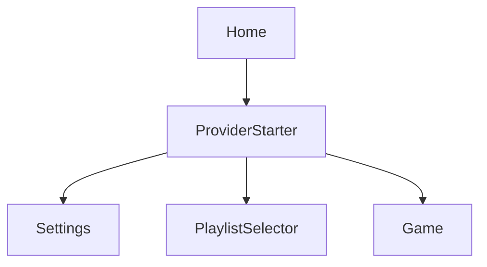

# Playlister — Features configuration

This file is the source of truth for how scenes (features) are built in the `Playlister` app target
and how they connect to each other. Humans and coding agents must follow it, and the
`playlister-new-feature` skill keeps the **Feature registry** and the **App map** below up to date.
Do not remove the `codegen` markers: the generator writes between them.

## Stack

- UI: SwiftUI only. Views compose components from the `PlaylisterUI` package; they never style raw controls.
- Language: Swift 6 language mode, strict concurrency. View models are `@MainActor @Observable`.
- Architecture: MVVM, feature based. One folder per feature under `Playlister/Features/`.
- Data: features never talk to Alamofire or DAOs. They reach the `PlaylisterData` package only through a
  repository's public API (`<Name>RepositoryProtocol`) and its public request/response protocols.

## Anatomy of a feature

Every new feature gets its own folder with this exact structure (example: `Profile`):

```
Features/Profile/
├── ProfileCoordinator.swift        # Entry point: builds the view and resolves navigation routes
├── ProfileDependencies.swift       # Dependency injection container of the feature
├── View/ProfileView.swift          # SwiftUI view built only with PlaylisterUI components
├── ViewModel/ProfileViewModel.swift# @MainActor @Observable state holder, calls the use case
├── Model/ProfileViewData.swift     # Display-ready data, owned by the view model as a variable
└── UseCase/ProfileUseCase.swift    # Business logic; calls the repository public API
```

### Responsibilities

| Type | Responsibility | Rules |
|---|---|---|
| `<Feature>Coordinator` | Initialises the view through `<Feature>Dependencies` and declares the routes (`Route` enum) to the features that can be opened from it. | Conforms to `Coordinator`. Only coordinators create other coordinators. |
| `<Feature>Dependencies` | Builds the use case, the view model and injects the repository. | The only place where concrete types are created. Keeps each dependency as a `private let` and exposes it through a `resolve<Name>()` function (`resolveRepository()`, `resolveUseCase()`, `resolveViewModel()`). It never builds the ViewData. |
| `<Feature>View` | Renders state. Adds PlaylisterUI components and localises text with `.localized("key")`. | No business logic, no networking, no hard-coded colors or fonts. |
| `<Feature>ViewModel` | Owns the screen state (`idle`, `loading`, `loaded`, `failed`) and the `viewData` variable. Adds each use case result to its own field of `viewData`. | Depends on `<Feature>UseCaseProtocol`, never on a repository. `private(set) var viewData`; the state never carries the ViewData. |
| `<Feature>ViewData` | Display model held by the view model. One field (and, if needed, one nested type) per use case result. | Value type, `Equatable` and `Sendable`, with `var` fields. Never maps response protocols and never exposes PlaylisterData types to the view. |
| `<Feature>UseCase` | Calls the repository through its **public API** and returns **only the data of the response**, mapped out of the PlaylisterData types into a ViewData field type. | Depends on `<Name>RepositoryProtocol` from `PlaylisterData`. Never builds or returns the whole ViewData. |

### Initialisers: only the container

`<Feature>View`, `<Feature>ViewModel` and `<Feature>UseCase` receive **only** `dependencies: <Feature>Dependencies`
in their `init`, and resolve everything else inside it through the container's `resolve…()` functions.
They never take a use case, repository, view model or view data as an `init` parameter.

```swift
// View
init(dependencies: ProfileDependencies) {
    _viewModel = State(initialValue: dependencies.resolveViewModel())
}

// ViewModel
init(dependencies: ProfileDependencies) {
    self.useCase = dependencies.resolveUseCase()
}

// UseCase (a Sendable struct: it stores what it resolves, not the container)
@MainActor
init(dependencies: ProfileDependencies) {
    self.repository = dependencies.resolveRepository()
}
```

- Naming: every function of the container that hands out a dependency is `resolve<Name>()`. Never `make<Name>()`.
- To add a dependency: store it as a `private let` in `<Feature>Dependencies`, add `resolve<Name>()`, and resolve it
  in the `init(dependencies:)` that needs it.
- The coordinator starts the view with `<Feature>View(dependencies: dependencies)`, and the container builds the
  others with `<Feature>ViewModel(dependencies: self)` and `<Feature>UseCase(dependencies: self)`.
- The use case `init` is `@MainActor` because the container is.

### Data flow

```
View ──▶ ViewModel ──▶ UseCase ──▶ <Name>RepositoryProtocol (PlaylisterData public API)
                                        │
View ◀── ViewModel.viewData ◀── response data ◀── <Name>ResponseProtocol
            (adds it to a field)   (use case maps it)
```

### ViewData lives in the view model

The view model owns the screen data as a variable, and each use case only hands it the data of its response:

```swift
// ViewData: one field per use case result
struct ProfileViewData: Equatable, Sendable {
    struct User: Equatable, Sendable { let name: String }
    var user: User?
}

// UseCase: returns only the data of the response, mapped out of PlaylisterData
func execute() async throws -> ProfileViewData.User {
    let response = try await repository.fetch(ProfileRequest(), serviceName: serviceName)
    return ProfileViewData.User(name: response.name)
}

// ViewModel: keeps the ViewData and adds each result to its own field
private(set) var state: State = .idle          // idle, loading, loaded, failed
private(set) var viewData = ProfileViewData()

func load() async {
    state = .loading
    do {
        viewData.user = try await useCase.execute()
        state = .loaded
    } catch {
        state = .failed(error.localizedDescription)
    }
}
```

- A new result never erases the rest of the data: assign only the field of that use case.
- The view reads `viewModel.viewData` (or view model properties built on it), and switches on `state`
  only to show loading or error.
- A screen with several use cases has one field per use case, and may have one `…Loaded` state per result.

### Navigation

- Each coordinator declares `enum Route: Hashable` with one case per child feature, and maps each case
  to the child's coordinator in `destination(for:)`.
- A view opens a child feature with `NavigationLink(value: <Parent>Coordinator.Route.<child>) { ... }`.
- The root feature is started by `App/RootView.swift` inside the `NavigationStack`.
- `RootView` binds the `NavigationStack` to `HomeCoordinator.path` (a `NavigationPath`), so every route pushed with
  `NavigationLink(value:)`, from any feature, lands on that one path. A coordinator that navigates from its view model
  appends a route to it (Home after signing in), and «Sign out» resets it to go back to Home. Never push with
  `navigationDestination(item:)` or `isPresented:`: value links pushed on top of those screens are lost.
- A view that needs a glass icon button as a link uses `NavigationLink(value:) { Image(systemName:) }` with
  `.buttonStyle(DSIconButtonStyle(diameter:))`, never a `DSIconButton` inside a `NavigationLink`.

### External display (AirPlay)

The game has its own screen for an external display (a TV through AirPlay or a cable) instead of mirroring the
iPhone: the TV shows the round in 16:9 for the room, and the iPhone keeps the controls.

- `App/AppDelegate.swift` gives the `windowExternalDisplayNonInteractive` scene role its own delegate,
  `App/ExternalDisplaySceneDelegate.swift`, which hosts `App/ExternalDisplayRootView.swift`. Every other scene keeps
  SwiftUI's default configuration. That is enough before iOS 27.
- From iOS 27 the system only connects that scene for a registered `UISceneAccessory`. `GameView` registers one
  with `.externalDisplayAccessory()` (`App/ExternalDisplayAccessory.swift`), with the same configuration and
  delegate, so the display has its own screen only during a game and mirrors the iPhone everywhere else.
- UIKit creates that scene, so it cannot receive a feature's dependencies. It reads the shared
  `Features/Game/ExternalDisplay/GameExternalDisplaySession.swift` instead: `GameViewModel` presents itself there in
  `load()` and takes itself off in `stop()`, and the scene delegate reports when a display connects or disconnects.
  `GameDependencies` injects the session (`resolveExternalDisplaySession()`).
- `GameExternalDisplayView` is the one view that does not take `init(dependencies:)`: it mirrors the view model of
  the iPhone's `GameView` and owns none of its own. It has no controls, because the display is not interactive.
- `View/GameViewModel+DesignSystem.swift` maps the game's state to design-system types for both views, so the iPhone
  and the TV always show the same round.
- Test it in the Simulator with *I/O > External Displays*.

### Localisation

- Strings live in `Resources/Localizable.xcstrings`. Keys follow `<featureName>.<element>`, e.g. `profile.title`.
- Components that show text expose `.localized("key")` (see `Packages/PlaylisterUI/DESIGN_SYSTEM.md`).

### Creating a feature

Use the `playlister-new-feature` skill, or run:

```
python3 scripts/codegen/new_feature.py --name <FeatureName> --parent <ExistingFeature> [--repository <RepositoryName>]
```

It creates the branch `feature/Playlister-<FeatureName>` from `develop`, the folder and classes above,
adds the route to the parent coordinator and updates this file.

## Feature registry

<!-- codegen:feature-registry:start -->
| Feature | Opened from | Repository |
|---|---|---|
| `Home` | — (root) | `Authorization`, `Login` |
| `ProviderStarter` | Home | `LastPlaylistRepository`, `SettingsRepository` |
| `Settings` | ProviderStarter | `SettingsRepository` |
| `PlaylistSelector` | ProviderStarter | `PlaylistsRepository`, `SongRepository` |
| `Game` | ProviderStarter | `Song`, `Player`, `Artist` |
<!-- codegen:feature-registry:end -->

## App map

Which feature opens which. `A --> B` means feature A can open feature B.

<!-- codegen:app-map:start -->

<!-- codegen:app-map:end -->
